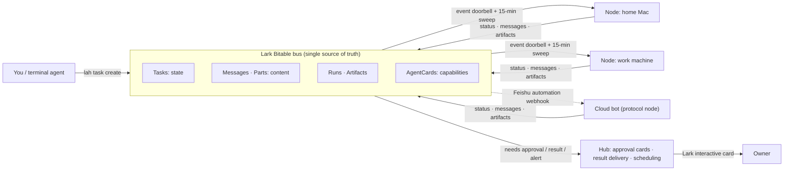
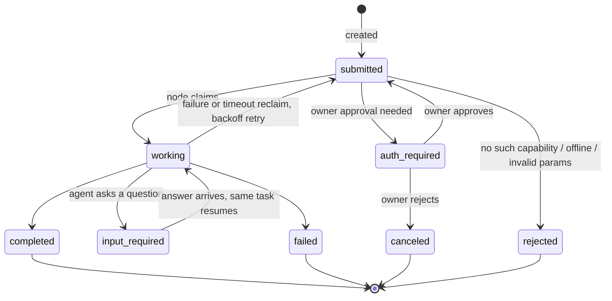

<div align="center">

# lark-a2a-hub

**Turn a Lark (Feishu) Bitable into a dispatch bus for multi-agent work.**
No server to run, no inbound ports, every step on the record.

[](https://github.com/backtomyfuture/lark-a2a-hub/actions/workflows/check.yml)
[](CHANGELOG.md)
[](docs/standard.md)
[](https://nodejs.org)
[](LICENSE)

[中文](README.md) · [Quick start](#quick-start) · [Standard](docs/standard.md) · [Architecture](docs/architecture.md) · [Configuration](docs/configuration.md) · [Changelog](CHANGELOG.md)

</div>

---

You have several machines and several agents: a Mac at home, a work box, a bot in the cloud. Each can do something useful.
Getting them to hand tasks to each other, ask questions midway, and wait for your approval before spending money or sending a message usually means building a server.

lark-a2a-hub skips the server: **it uses a Bitable you already have as the message bus and state layer.**
Each machine runs a small daemon, `lah`. It only connects outward and opens no inbound port. It claims tasks, launches a local script or agent, and writes the result back to the table.
Actions that need the owner's authorization pop up an approval card in Lark, and nothing runs until the owner taps approve.

Running in production. The data model comes from the [A2A protocol](https://a2a-protocol.org) (eight task states, messages separate from artifacts, capability cards). Communication is table reads and writes only; A2A's HTTP transports are not implemented.

> The detailed docs under `docs/` (standard, architecture, configuration) are written in Chinese. This page covers the essentials.

## Why use it

| You want | How it works |
|---|---|
| **No servers to operate** | The bus is a Lark Bitable. No database, queue or public endpoint to manage |
| **Any machine can join** | One-line install. The wizard detects Claude Code, Codex, agy, Paseo, Orca and others on the machine and generates the capability table |
| **Add capabilities without code** | A capability is one command template in `commands.json`. The kernel contains no agent-specific code |
| **Humans approve risky actions** | Sending messages, editing or deleting data, spending money, changing permissions all go through an approval card that only the owner can answer |
| **Debuggable after the fact** | Status, messages, runs and artifacts all live in the tables; `lah task why` rebuilds a timeline in one command |
| **Crash-safe** | An in-flight ledger keeps a restart from running a command twice. Failures back off and retry with a cap, and a hop limit breaks loops |

## How it works



Every participant (node, hub, cloud bot) does two things: **read the table, write the table.** Event pushes are only a doorbell; content is always fetched from the table, so a dropped connection or restart loses no work.

A task's lifecycle:



> `auth_required` and `input_required` in the diagram are `auth-required` and `input-required` in the standard. Terminal states are immutable; follow-up work becomes a new task in the same `Context_ID`.

## Quick start

Prerequisites: Node.js >= 20 and a Lark Bitable (ask your hub admin, or build your own, see below).

**1. Install**

```bash
curl -fsSL https://raw.githubusercontent.com/backtomyfuture/lark-a2a-hub/main/install.sh | sh
```

**2. Configure with the wizard** (resolves table IDs, writes credentials with mode 600, detects local agents, subscribes to events, runs a self-check, optionally registers autostart)

```bash
lah setup
```

**3. Verify**

```bash
lah doctor      # connectivity and capability registration
lah daemon      # foreground trial (already resident if you chose autostart)
```

Dispatch a task and read the receipt:

```bash
lah task create --to <node> --cap <cap_id> --text "summarize today's todos"
lah present --pop               # receipts land locally, no chat spam in Lark
lah task reply --task TASK-XXXX --text "answer"   # when the task asks you something, same task resumes
lah task why TASK-XXXX          # timeline when something goes wrong
```

The wizard also installs the `lah` Skill for your terminal agent (`~/.agents/skills/lah`), so it can start cross-node work on its own.

**Running your own hub?** Create the seven tables per [base-schema.md](docs/base-schema.md), then `lah setup --role hub --owner <owner open_id>`. One process serves as both hub and execution node. See the [configuration reference](docs/configuration.md#7-自建中台hub-角色).

**A cloud bot that cannot run a daemon?** Join through the Feishu automation webhook as a protocol node: [configuration reference](docs/configuration.md#8-接入外部-bot飞书自动化--webhook) and the [protocol node runbook](docs/protocol-node-runbook.md).

## Feature overview

- **One process, two roles**: the hub is a single-process superset of a node, `lah daemon --role node|hub`, one config directory.
- **Capabilities as config**: one template in `commands.json` plugs in a script (`json` mode), an agent CLI (`agent` mode) or a resident agent itself (`inbox` mode). Editing the file hot-reloads the cards. A broken file keeps the previous table and pauses new claims until fixed.
- **Questions and resume**: an agent can ask the requester mid-task (`input-required`); the answer resumes the same task. With a session id, `resume_command` can continue the same conversation.
- **Owner approval**: tasks marked `approve` (per row or per local capability) enter `auth-required`; the hub sends the card early, and only the owner's tap counts. Forged decision rows have no effect.
- **In-flight ledger**: a `direct` command is written to a ledger before it is spawned. After a restart, a live process only gets its heartbeat renewed, never a second run. If the process identity does not match, no signal is sent, so nothing gets killed by mistake.
- **Disciplined failure**: at most 2 retries with backoff starting at 60 s, doubling, capped at 10 min. More than 8 hops trips the breaker. Invalid receipts and failed submissions are not re-run, to avoid repeating side effects.
- **Observable**: `lah task why` joins task, messages, runs, artifacts and local pending state. Receipts may carry `USAGE:`, accumulated into task metadata.
- **Cancel and follow-up**: `lah task cancel` withdraws a task. A completed receipt may carry `LATER:`, and the hub creates a follow-up task in the same context when it comes due.
- **Scheduling**: the hub owns the only network-wide clock. Cron rows in the Rules table create tasks on schedule, idempotently.
- **LAN context**: on macOS a daemon cannot reach the LAN; a `carrier` runs those commands in your terminal. When the carrier is offline, tasks are rejected explicitly, never silently downgraded.
- **Tests and CI**: `npm test` (Node's built-in `node:test` and an in-memory bus, no real Base) covers the core paths. GitHub Actions runs on ubuntu and macOS with Node 20 and 22.

## Security model

These are red lines written into the standard and the code:

- **Outbound only**: no listening ports (the carrier's local unix socket excepted), no port mapping or tunnels, no inbound webhook. Card callbacks also use the long connection.
- **Instructions and data are separate**: what command runs, in which directory, in which context comes only from the local `commands.json`. Task text and parameters are written as data into a restricted-permission `input.json`, never spliced into the instruction. A task whose parameters smuggle in execution control keys is rejected, which blocks prompt-injection takeover.
- **Owner approval**: sending messages, editing or deleting data, spending money, submitting forms and changing permissions all need approval. Only a structured decision written by the hub on the owner's action counts, not text and not a flag on the task row. A node can tighten the approval class locally but never loosen it.
- **Credentials stay off the bus**: secrets live only in a mode-600 file on the machine. The bus carries tasks and file pointers. Logs never print credentials.
- **Append-only messages**: Messages and Parts are never modified or deleted, and terminal tasks are never reopened.
- **Fail loudly**: when a task cannot run, the system says so, marks the capability offline and rejects. It never quietly takes another path.

## Design trade-offs

The kernel design borrows from [agent-autoloop](https://github.com/KKKKhazix/agent-autoloop) (thin kernel, command templates for agents, structured receipts, hop breaker, instruction/data separation, one-line install). The differences come from the problem we target:

| | agent-autoloop | lark-a2a-hub |
|---|---|---|
| Where state lives | Its own kernel database; chat tools act as the decision surface | A Lark Bitable is the bus; nothing for you to self-host |
| Runtime form | Lives inside the user's session | Unattended, resident, starts at boot |
| Data model | Its own | A2A-shaped: eight states, messages separate from artifacts, capability cards |
| Cross-machine work | Centered on a local fact log | Nodes cooperate through one table; the hub centralizes approval and delivery |

We took its resilience and observability ideas, and left out the SQLite fact log, inbound HTTP and third-party plugin loading, which conflict with our outbound-only, nothing-to-self-host red lines. Use this project when several machines and agents must cooperate over one protocol with an audit trail; otherwise read its docs and pick what fits.

## Documentation

| Document | Contents |
|---|---|
| [docs/configuration.md](docs/configuration.md) | Config directory, `node.json` / `commands.json`, receipt conventions, carrier, CLI cheat sheet (Chinese) |
| [docs/standard.md](docs/standard.md) | **The hub standard (normative)**: seven-table model, eight-state machine, messaging / approval / idempotency protocol (Chinese) |
| [docs/architecture.md](docs/architecture.md) | Layering, core decisions and rationale, lifecycle, failure model |
| [docs/base-schema.md](docs/base-schema.md) · [schema/](schema/) | Field-level definitions of the seven tables, generated from the live Base |
| [docs/hub-integration.md](docs/hub-integration.md) | Hub duties, task-creation discipline, presentation and approval loops |
| [docs/agent-templates.md](docs/agent-templates.md) | Final headless CLI commands, permission semantics and known pitfalls |
| [docs/protocol-node-runbook.md](docs/protocol-node-runbook.md) | How a daemon-less agent joins by watching the tables |
| [DESIGN.md](DESIGN.md) | Node adapter design and macOS LAN findings |
| [CHANGELOG.md](CHANGELOG.md) | Release notes |

## Contributing

Issues and PRs are welcome. Read [CONTRIBUTING.md](CONTRIBUTING.md) first. To verify locally:

```bash
npm install --omit=dev && npm test
```

## License

[MIT](LICENSE)
