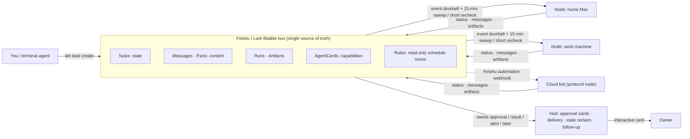
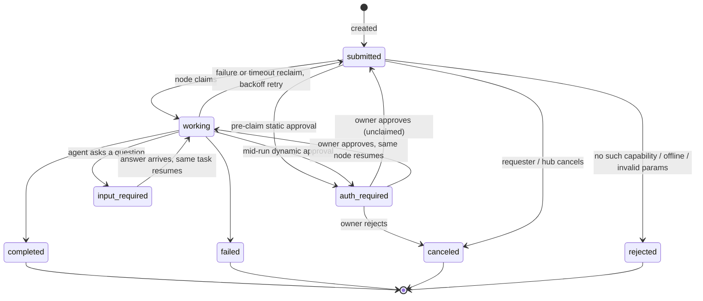

<div align="center">

# lark-a2a-hub

**Turn a Lark (Feishu) Bitable into a dispatch bus for multi-agent work.**
No server to run, no inbound ports, every step on the record.

[](https://github.com/backtomyfuture/lark-a2a-hub/actions/workflows/check.yml)
[](CHANGELOG.md)
[](docs/standard.md)
[](https://nodejs.org)
[](LICENSE)

[中文](README.md) · [Quick start](#quick-start) · [How it works](#how-it-works) · [Core capabilities](#core-capabilities) · [Common commands](#common-commands) · [Standard](docs/standard.md) · [Configuration](docs/configuration.md) · [Changelog](CHANGELOG.md)

</div>

---

You have several machines and several agents—a Mac at home, a work machine, a bot in the cloud—each with its own tools and permissions. Getting them to dispatch tasks to each other, ask questions midway, and pause for your approval before spending money or sending messages usually means building and operating a server.

**lark-a2a-hub skips the server: it uses a Lark / Feishu Bitable you already have as the message bus and state layer.** Each machine runs a lightweight daemon, `lah`, which only opens outbound connections and no inbound ports. It claims tasks, launches a local script or agent, and writes results and artifacts back to the table. High-risk actions pop up a signed interactive approval card in Lark/Feishu and only continue after the owner taps approve.

Running in production. The data model borrows from the [A2A protocol](https://a2a-protocol.org) (eight task states, messages separate from artifacts, capability cards). Communication is strictly table reads and writes; A2A's HTTP transports are not implemented.

> The detailed documentation under `docs/` (standard, architecture, configuration) is written in Chinese. This page covers the essentials.

## Why use it

| You want | How it works |
|---|---|
| **No servers to operate** | The bus is a Lark / Feishu Bitable. No database, message queue, or public endpoint to manage |
| **Any machine can join** | One-line install. The wizard detects Claude Code, Codex, agy, Paseo, Orca, and others locally to generate the capability table |
| **Add capabilities without code** | Three-level addressing: node → worker (an agent on that node) → skill, all declared in local `commands.json`; the kernel stays thin |
| **Humans approve risky actions** | Sending messages, mutating data, spending money, or changing permissions supports two-phase approval (pre-claim & mid-run), verified by the owner and signed by the hub |
| **Debuggable after the fact** | Status, messages, runs, and artifacts live in the tables; `lah task why` rebuilds the complete timeline in one command |
| **Crash-safe** | An in-flight ledger stops restarts from running a command twice. Failures back off with a retry cap, and a hop limit breaks loops |

## Quick start

Prerequisites: **Node.js >= 24** and a Feishu or Lark Bitable (request access from your hub admin, or clone/create your own below).

### 1. One-line install

macOS / Linux:

```bash
curl -fsSL https://raw.githubusercontent.com/backtomyfuture/lark-a2a-hub/main/install.sh | sh
```

Windows (PowerShell):

```powershell
irm https://raw.githubusercontent.com/backtomyfuture/lark-a2a-hub/main/install.ps1 | iex
```

### 2. Configure and verify

```bash
lah setup       # detects or guides cloning the 7 tables, writes mode-600 credentials, detects local agents, installs the lah Skill, and optionally sets up autostart
lah doctor      # verifies config validity, bus connectivity, and AgentCards registration
```

Press Enter in the wizard to register user-level autostart and start the daemon right away (`lah daemon` also runs in the foreground for testing). The wizard installs the `lah` Skill (`~/.agents/skills/lah`) so your terminal agent can dispatch cross-node tasks on its own.

### 3. Dispatch and receive receipts

```bash
lah task create --to <node> --worker <agent> --text "summarize today's todos"
lah present --wait 120 --task TASK-XXXX --pop     # waits locally for the receipt without spamming Lark chats
lah task reply --task TASK-XXXX --text "answer"   # resumes the same task when the agent asks a question (input-required)
lah task why TASK-XXXX                            # inspects the full timeline (status, messages, runs, artifacts)
```

<details>
<summary>Install paths, autostart behavior, and upgrades</summary>

- **Install locations**: `~/.hub-node/app` on Unix (`%USERPROFILE%\.hub-node\app` on Windows), leaving existing config untouched. On Windows, `bin\lah.cmd` and `bin\hub-node.cmd` are added to the user `PATH` (open a new terminal if `lah` is not yet recognized). Skip installing the Skill with `LAH_SKIP_SKILL=1` (Unix) or `$env:LAH_SKIP_SKILL=1` (Windows).
- **Autostart**: macOS uses a LaunchAgent, Linux uses a systemd user service, and Windows uses a Task Scheduler task for the current user (no admin needed, starts at logon, restarts ~5 seconds after an unexpected exit, stays active on battery). Logs go to `daemon.log` in the config directory. Remove autostart with `lah service --remove`.
- **Upgrades**: On git checkouts, run `lah update` (`lah update --check` to inspect first) to pull, reinstall dependencies, and refresh the Skill without touching configuration. Tarball installs have no `.git`—re-run the install command above. Windows `lah.cmd` uses a relative path to `app\bin\lah.mjs`, so it stays valid across updates.

</details>

### Other deployment modes

| Scenario | Setup | Reference |
|---|---|---|
| **Self-host a hub** | Open the [Feishu Bitable standard template](https://my.feishu.cn/wiki/OABiwbe3Si1FoCkelzYcYwTQ6de?base_hp_from=larktab&table=tblIvRscY5Mev3Do&view=vewzhNeMCe) and click "Use this template" to clone all 7 tables (`lah setup` also opens it if no Base is found), then run `lah setup --role hub --owner <owner open_id>`; one process acts as both hub and execution node | [Configuration · Self-host hub](docs/configuration.md#8-自建中台hub-角色) |
| **International Lark tenant** | Pass `lah setup --domain lark`; Lark tenants create the 7 tables manually from the schema | [Base schema](docs/base-schema.md) |
| **Cloud bot without a daemon** | Join via Feishu automation webhook as a protocol node | [Configuration · External bots](docs/configuration.md#9-接入外部-bot飞书自动化--webhook) · [Protocol node runbook](docs/protocol-node-runbook.md) |

## How it works

### 1. Shared Bitable bus: read and write only

Every participant (nodes, hub, cloud bots) does just two things: **read the table, write the table**. Event pushes are only a doorbell; payloads are always fetched back from the table so dropped connections or restarts never lose work. Receipts land in the requester's local queue (`present_queue.jsonl`) via the hub instead of flooding chat rooms.


<details>
<summary>Precise diagram (Mermaid source)</summary>



</details>

### 2. Three-level addressing: Node → Worker → Skill

Work routing separates identity into three layers: **Node** (the machine), **Worker** (an agent on that machine, represented in the roster by `Skill_ID=agent`), and **Skill** (a specialized skill or deterministic node script).

Callers can target a specific worker (`--to <node> --worker <worker> --cap <skill>`, never silently swapped) or omit the worker and let the node pick its default.


### 3. Eight-state task lifecycle

Tasks strictly progress through the eight A2A states. Terminal states (`completed`, `failed`, `canceled`, `rejected`) are immutable; follow-up work spawns a new task under the same `Context_ID` referencing its predecessor.


<details>
<summary>Precise state diagram (Mermaid source)</summary>



> `auth_required` and `input_required` in the diagram correspond to `auth-required` and `input-required` in the standard. If a static approval gate triggers on `input-required`, the task also transitions to `auth-required` and resumes on the original node after approval.

</details>

<details>
<summary>Field test: cross-node split, parallel run, and relay verification</summary>


</details>

## Core capabilities

- **Unified roles & flexible nodes**
  - **Single-process superset**: `hub` is a superset of `node` via `lah daemon --role node|hub`—it runs local capabilities while handling network-wide approval cards, result presentation, stale task recovery, and `later` follow-ups.
  - **Host & standalone agent modes**: `kind: host` nodes detect local CLIs and spawn jobs per `commands.json`; `kind: agent` standalone nodes read/reply via `agent_inbox.jsonl` (`inbox` mode).
  - **Hot reload & safe fallback**: Edits to `commands.json` sync to `AgentCards` automatically; invalid JSON preserves the previous table and pauses new claims until repaired.
  - **LAN isolation (`carrier`)**: When a macOS background daemon cannot reach LAN targets, `lah host` runs a terminal `carrier` over a local unix socket. Offline carriers mark capabilities `offline` and explicitly reject tasks—never silently downgrading to direct execution.

- **Mid-task Q&A & two-phase owner approval**
  - **Same-task Q&A resume**: Agents emitting ```` ```agent-ask ```` (or `need_input` / `lah inbox ask`) enter `input-required` and resume on the same task once answered; `resume_command` continues the conversation when a local `session.json` exists.
  - **Pre-claim + mid-run approval**: Tasks or capabilities configured with `approval_class=approve` pause before claim; running agents can also transition `working → auth-required` mid-run (`agent-auth` / `need_auth` / `lah inbox auth`) and resume with verified approval records.
  - **ed25519 signed decisions**: The hub signs each `auth_decision` with its private key, and nodes configured with `hubPublicKey` reject forged decision rows. Interactive callbacks update the card within 3 seconds to prevent double-clicks.
  - **Short recheck for pending tasks**: Nodes with `input-required` or `auth-required` tasks tighten their sweep interval to 60 s for the first 10 minutes and 180 s up to 60 minutes, avoiding long waits if a doorbell event is missed.

- **Resilience & observability**
  - **In-flight ledger**: `direct` commands write `runs/<Task_ID>/entry.json` before spawning so daemon restarts renew heartbeats for live processes instead of double-running them, and never signal mismatched PIDs.
  - **Backoff, caps, and breakers**: Failures and timeout reclaims share a 2-retry limit with exponential backoff (60 s to 10 min); hop counts above 8 trip the breaker; invalid receipts or partial bus submissions do not re-run side effects.
  - **Heartbeat throttling & timeline debugging**: Sweep-path heartbeats throttle at 90 s minimum intervals to cut Bitable API load; `lah task why <Task_ID>` prints tasks, messages, runs, artifacts, and pending local state; `USAGE:` receipts accumulate token/cost metadata.

- **Local scheduling & scheduled follow-ups**
  - **Node-local clocks**: Scheduled tasks run on local node clocks—`schedules.json` on hosts and `lah task begin` on standalone agents—creating `submitted` tasks with idempotent keys while `Rules` serves as a read-only overview mirror.
  - **`LATER:` follow-ups & cancellation**: Completed receipts with `LATER:` let the hub schedule a follow-up task in the same `Context_ID` when due; `lah task cancel` lets requesters cancel their own tasks or the hub cancel any non-terminal task, delivering cancellation receipts locally.

## Common commands

Commands default to `~/.hub-node` (override with `--config <dir>` or `HUB_NODE_HOME`). Full flags and options are documented in [Configuration · CLI cheat sheet](docs/configuration.md#7-cli-速查).

| Area | Command | Purpose |
|---|---|---|
| **Setup & Ops** | `lah setup [--role node\|hub] [--domain feishu\|lark]` | Wizard: resolve Base tables, detect local agents, install Skill, configure autostart |
| | `lah doctor [--role node\|hub] [--probe <host:port>]` | Read-only checks for config, connectivity, AgentCards, and schedules |
| | `lah service [--role node\|hub] [--remove]` | Install or remove user-level autostart service |
| | `lah inventory` | Read-only summary of this node's AgentCards and tasks by state |
| | `lah host` | Run the LAN `carrier` process in a user terminal |
| | `lah update [--check]` | Update program files from git without touching configuration |
| **Tasks & Debug** | `lah task create --to <node> [--worker <W>] [--cap <skill>] --text …` | Validate roster and dispatch a task |
| | `lah present [--wait <sec>] [--task <ID>] [--pop]` | Read or wait for terminal/question receipts in the local queue |
| | `lah task reply --task <ID> --text …` | Answer an `input-required` question and resume the task |
| | `lah task cancel --task <ID> [--text …]` | Cancel a non-terminal task |
| | `lah task why <ID> [--json]` | Reconstruct full timeline and pending local submissions |
| **Scheduling** | `lah schedule ls \| add \| rm \| enable \| disable` | Manage local `schedules.json` and sync the `Rules` mirror |
| | `lah task begin --schedule <id> [--cap <cap>] [--text …]` | Trigger a scheduled task from an agent's own clock |
| **Standalone Agent** | `lah inbox [--pop] [--json]` | Read pending jobs for a `kind=agent` node |
| | `lah inbox done \| ask \| fail \| auth --task <ID> --text …` | Submit completion, question, failure, or mid-run approval request |

## Security model

These invariants are enforced across both the standard and the codebase (see [SECURITY.md](SECURITY.md) for the full threat model):

- **Outbound only**: No listening ports (other than the carrier's local unix socket), no port forwarding or reverse tunnels, and no inbound webhooks. Event subscriptions and card callbacks run over long-lived outbound connections.
- **Instructions separate from data**: Executable commands, directories, and contexts come solely from local `commands.json`. Task instructions, parameters, and file pointers go into a mode-600 `input.json` and are never interpolated into shell commands; parameters containing execution control keys (`command`, `cwd`, `context`, `agent`, `worker`, etc.) are rejected outright.
- **Signed owner approval**: Outbound messages, data deletion/mutation, spending, form submission, and permission changes require `auth-required`. Only structured `auth_decision` records verified as coming from the owner and signed by the hub count—never free text or flags on the task row. Nodes can tighten approval classes locally, never loosen them.
- **Credentials stay off the bus**: App secrets and the hub's ed25519 private key remain in mode-600 local files. The Bitable carries only task records and file pointers; logs never print credentials or tokens.
- **Append-only messages**: `Messages` and `Parts` are never modified or deleted, and terminal tasks are never reopened.
- **Fail loudly**: Offline carriers, missing capabilities, or invalid config modes result in explicit `offline` marks or `rejected` states—never silent fallbacks.

## Design trade-offs

The thin-kernel design borrows from [agent-autoloop](https://github.com/KKKKhazix/agent-autoloop) (command templates for agents, structured receipts, hop breakers, instruction/data separation, one-line install), adapted to a different problem space:

| | agent-autoloop | lark-a2a-hub |
|---|---|---|
| **Where state lives** | Built-in local kernel database; chat tools as the decision surface | Feishu / Lark Bitable as the bus; nothing for users to self-host |
| **Runtime model** | Runs inside the user's session | Unattended, resident daemon with boot autostart |
| **Data model** | Custom | A2A-shaped: eight states, messages separate from artifacts, 3-layer cards |
| **Cross-machine work** | Centered on a local fact log | Multiple nodes collaborate through one table; hub centralizes approval and presentation |

We kept its resilience and observability ideas and left out local SQLite fact logs, inbound HTTP, and third-party plugin loading, which conflict with our outbound-only and zero-server red lines. Choose `lark-a2a-hub` when multiple machines and agents must coordinate under one auditable protocol; see `agent-autoloop`'s docs for single-machine interactive loops.

## Documentation

| Document | Contents |
|---|---|
| [docs/configuration.md](docs/configuration.md) | Config directory, `node.json` / `commands.json` / `schedules.json`, receipts, carrier, log metrics, full CLI cheat sheet (Chinese) |
| [docs/standard.md](docs/standard.md) | **The hub standard (normative)**: seven-table model, eight-state machine, communication / approval / idempotency / scheduling protocol (Chinese) |
| [docs/architecture.md](docs/architecture.md) | Layering, core decisions and rationale, lifecycle, and failure model |
| [docs/base-schema.md](docs/base-schema.md) · [schema/](schema/) | Field-level definitions of the seven tables, generated from the live Base |
| [docs/hub-integration.md](docs/hub-integration.md) | Hub duties, task-creation discipline, presentation and approval loops |
| [docs/agent-templates.md](docs/agent-templates.md) | Headless CLI templates, permission semantics, and known pitfalls |
| [docs/protocol-node-runbook.md](docs/protocol-node-runbook.md) | How a daemon-less cloud agent integrates via table polling + webhooks |
| [SECURITY.md](SECURITY.md) | Trust model, deployment advice, and vulnerability reporting |
| [DESIGN.md](DESIGN.md) | Node adapter design and macOS LAN findings |
| [CHANGELOG.md](CHANGELOG.md) | Release notes |

## Contributing

Issues and PRs are welcome. Read [CONTRIBUTING.md](CONTRIBUTING.md) first. Verify locally with Node's built-in test runner and in-memory mock bus (no live Bitable required):

```bash
npm install --omit=dev && npm test
```

GitHub Actions continuously runs syntax checks and `npm test` on `ubuntu-latest` and `macos-latest` with Node 24.

## License

[MIT](LICENSE)
