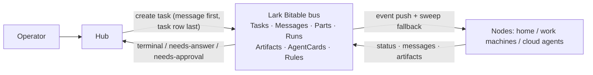

# lark-a2a-hub — Multi-Agent Hub on a Lark Bitable Bus

[](LICENSE)
[](https://nodejs.org)
[](docs/standard.md)
[](CHANGELOG.md)

[中文](README.md) · [Standard](docs/standard.md) · [Architecture](docs/architecture.md) · [Changelog](CHANGELOG.md)

A production multi-agent collaboration system: **a Lark (Feishu) Bitable acts as
the message bus and state layer**, with a data model borrowed from the A2A
protocol. One hub decomposes work, dispatches tasks, runs approvals and
presents results; any terminal with the node adapter installed can join and
work, and cloud agents can join directly by following the protocol. Tasks have
exactly one entry surface and one state surface, fully auditable end to end.

> Direction (standard v3.5): the hub is a logical role and a **single-process
> superset** of a node, carried by `lah daemon --role node|hub` (CLI name
> `lah`, with a `hub-node` compatibility alias). One process and one config
> directory can serve both as the hub (network-wide approval cards, result
> presentation, staleness alerts) and as an execution node (claim and run
> tasks). This repository contains the only Node implementation. Wake-up modes
> are ws / poll / webhook (webhook means Feishu automation outbound
> notifications; no process in this project ever pushes, and none ever opens a
> listening port). The hub role forces ws.

What's in the repo:

| Part | Location | Description |
|---|---|---|
| Hub standard v3.5 | [docs/standard.md](docs/standard.md) | Seven-table object model, A2A eight-state machine, messaging / approval / idempotency protocol (normative) |
| Architecture | [docs/architecture.md](docs/architecture.md) | Layering, core decisions and rationale, lifecycle, failure model |
| Base schema | [docs/base-schema.md](docs/base-schema.md) · [schema/](schema/) | Field-level definitions of the seven tables, generated from the live Base (generator included) |
| Hub integration | [docs/hub-integration.md](docs/hub-integration.md) · `src/hub/` | Hub duties, task-creation discipline, presentation and approval loops; implemented by `lah daemon --role hub` |
| Node adapter | `bin/` `src/` · [DESIGN.md](DESIGN.md) | Turns any terminal into an execution node: claim → launch local script/Agent → collect receipt → log the run |
| Protocol nodes | [docs/protocol-node-runbook.md](docs/protocol-node-runbook.md) | How a daemon-less agent joins by watching the tables (same protocol) |



## Quick start

### Path A: join an existing hub (install one node)

Get the Base link from your hub admin — three steps:

1. **Install** (requires Node.js >= 20):
   ```bash
   curl -fsSL https://raw.githubusercontent.com/backtomyfuture/lark-a2a-hub/main/install.sh | sh
   ```
   Installs to `~/.hub-node/app`; the entry point is linked to
   `~/.local/bin/lah` (with the `hub-node` alias kept).

2. **Configure with the wizard**:
   ```bash
   lah setup [--kind host|agent]
   ```
   - **`kind: host`** (a computer, default): auto-discovers the lark-cli app,
     detects locally installed agents (Claude Code, Codex, agy, Paseo, Orca,
     …) and generates `commands.json`; the daemon launches them as
     subprocesses to do the work.
   - **`kind: agent`** (a standalone agent entity, e.g. Muse): the agent
     itself is the worker. setup never scans PATH and registers no external
     CLI; the only capability is `agent` (`mode: inbox`). The daemon claims
     tasks into a local `agent_inbox.jsonl` and keeps heartbeats alive; the
     agent picks work up and closes it out itself.
   > [!IMPORTANT]
   > `kind=agent` + inbox only fits agents with a resident process that can
   > call `lah inbox`. Cloud agents without one (e.g. Grok Bot) must use the
   > protocol-node path (`Receive_Mode=automation` + Feishu automation
   > webhook) instead — an external webhook cannot wake a local inbox file.
   
   The wizard resolves the six table IDs, writes `app.env` (mode 600) and
   `node.json`, subscribes to document events for second-level wake-up, runs
   `doctor`, and can register boot autostart.

3. **Verify**:
   ```bash
   lah doctor      # connectivity and capability registration
   lah daemon      # foreground trial (already resident if autostart was set)
   ```
   The wizard also installs the `lah` Skill for terminal agents
   (`~/.agents/skills/lah`), so a terminal agent can dispatch cross-node work
   directly.

---

### Dispatching and interacting (CLI / agent surface)

Any joined node or terminal agent can dispatch tasks and receive results on
the return path:

- **Dispatch**:
  ```bash
  lah task create --to <Target_Node> --cap <Skill_ID> --text "instruction" [--params '{"k":"v"}'] [--idempotency-key <key>]
  ```
- **Consume receipts** (delivered to local files, no chat spam in Feishu):
  ```bash
  lah present --pop
  ```
  Reads and drains this node's receipt queue
  (`~/.hub-node/present_queue.jsonl`). A `present_bell` file next to it is
  refreshed whenever new receipts land, so a local agent can watch one mtime
  instead of polling the queue.
- **Answer a question**: when a task is `input-required`, reply on the same
  task and the executor resumes in place:
  ```bash
  lah task reply --task TASK-XXXX --text "answer"
  ```
- **Inspect**: `lah task show TASK-XXXX`
- **Approvals**: actions needing the owner's authorization move to
  `auth-required`; the hub sends an approval card in Feishu, and the owner's
  tap resumes or cancels the task. Forged decision rows written directly to
  the table do not take effect (verified in testing).
- **Inbox workflow** (for `kind: agent` nodes):
  ```bash
  lah inbox --pop                                                     # pick up work
  lah inbox done --task TASK-XXXX --text "result" [--artifact <path>] # close out, receipt returns to the requester
  lah inbox ask  --task TASK-XXXX --text "question"                   # → input-required
  lah inbox fail --task TASK-XXXX --text "reason"                     # → failed, requester notified
  ```

---

### Path B: run your own hub

One machine can be both hub and node, one process, one config directory:

1. **Prepare the Base**: create the seven standard tables per
   [docs/base-schema.md](docs/base-schema.md), get the Base link and the
   owner's `open_id`, then install as above.
2. **Configure and start**:
   ```bash
   lah setup --role hub --owner <owner-open-id>
   lah doctor --role hub
   ```

---

### External bots (e.g. Grok Bot): Feishu automation + webhook

For agents hosted on external cloud platforms — no resident process, no Node
daemon, no long connection:

1. **Register** the bot's capability in AgentCards with
   `Receive_Mode=automation`.
2. **Feishu automation**: when a Tasks row is created or changes state with
   `Target_Node` = that bot, Feishu automation POSTs to the bot's public
   endpoint — **IDs only (Task_ID, status, Msg_ID), never task bodies or
   secrets**.
3. **Fetch and write back**: on the webhook doorbell, the bot reads
   Messages/Parts via the Feishu REST API, executes, and writes back
   Messages, Parts, Runs and the Tasks status per the A2A-shaped protocol. A
   low-frequency sweep (e.g. every 15 min) covers missed events.

> **Red line**: daemons in this project never open listening ports, port
> mappings or reverse tunnels, and never push to external nodes (standard §0.3,
> §10.3). Outbound notification is driven entirely by Feishu's official
> Bitable automation. See the [protocol node runbook](docs/protocol-node-runbook.md).

## Node configuration notes

- `node.json`: node identity (node/zone), bus parameters (baseToken/tables),
  credential source, poll and sweep intervals.
- `commands.json`: the capability table. Keys are Skill_IDs, values are
  command templates — `mode: "json"` for scripts (task envelope on stdin,
  result JSON on the last stdout line) and `mode: "agent"` for agent CLIs
  (template contains `{prompt}`). Adding, changing or removing a capability
  means editing this file only; the daemon reconciles AgentCards from it and
  marks removed capabilities `Dispatchable=No`.
- Capabilities come in three tiers — deterministic scripts, a designated local
  agent running a designated skill, and general agent+tooling — all just
  command templates. The daemon is a thin shell with no built-in executors.
- Credentials live only on the node, never on the bus; nodes make outbound
  connections only and open no listening ports.

### carrier: capabilities that need the LAN (macOS)

Daemons launched by launchd on macOS are blocked from the LAN by the local
network privacy mechanism (DESIGN.md §9). Mark such capabilities
`"context": "carrier"` in `commands.json` and run, in an everyday terminal:

```bash
lah host     # foreground; keep the terminal open; Ctrl-C to exit
```

The daemon hands those commands to the carrier over a local unix socket.
When the carrier is offline the capabilities are marked offline on their
cards and tasks are rejected explicitly — never silently run directly.
Probe a target through the carrier with `lah doctor --probe <host:port>`.

## Versions and changes

See [CHANGELOG.md](CHANGELOG.md). Contributing: [CONTRIBUTING.md](CONTRIBUTING.md).

License: MIT
