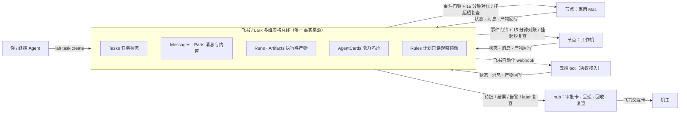
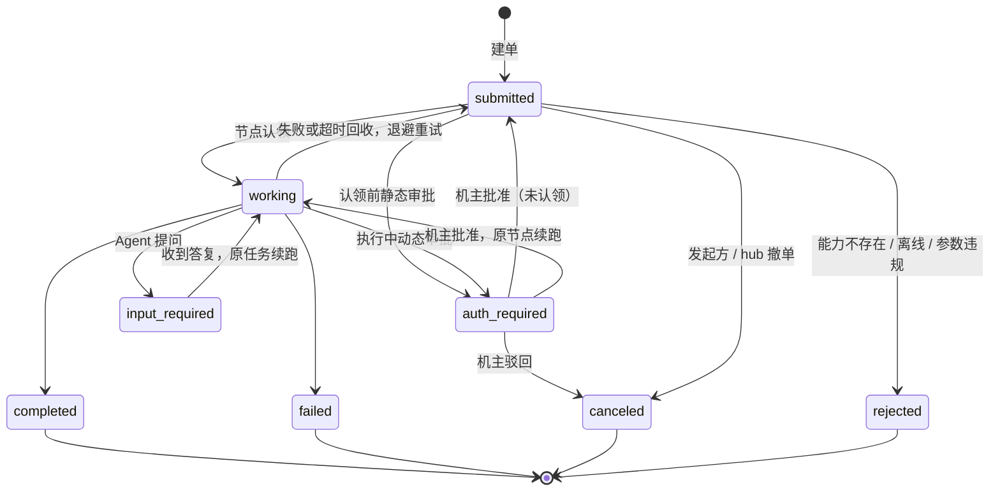

<div align="center">

# lark-a2a-hub

**把飞书 / Lark 多维表格变成多 Agent 的调度总线。**
零服务器、零入站端口、每一步都留痕可查。

[](https://github.com/backtomyfuture/lark-a2a-hub/actions/workflows/check.yml)
[](CHANGELOG.md)
[](docs/standard.md)
[](https://nodejs.org)
[](LICENSE)

[English](README.en.md) · [快速上手](#快速上手) · [工作原理](#工作原理) · [核心能力](#核心能力) · [常用命令](#常用命令) · [中台标准](docs/standard.md) · [配置参考](docs/configuration.md) · [更新日志](CHANGELOG.md)

</div>

---

你手头有好几台机器和好几个 Agent——家里的 Mac、办公机、云端 bot，各有各的专长和权限。想让它们互相派单、半路追问、碰到花钱或对外发消息的动作时先让你点头，通常得自己架设和维护一套服务端。

**lark-a2a-hub 省掉服务端：直接拿你已有的飞书 / Lark 多维表格当消息总线和状态层。** 每台机器运行一个轻量守护进程 `lah`，只往外连、不开任何入站端口，认领任务、拉起本机脚本或 Agent，把结果和产物回写进表里；需要机主授权时在飞书里弹一张签名校验的审批卡，点过才继续跑。

已在生产运行。数据模型借自 [A2A 协议](https://a2a-protocol.org)（八态任务、消息与产物分离、能力名片），通信只读写表，不实现 A2A 的 HTTP 传输。

## 为什么用它

| 你想要 | 它怎么做 |
|---|---|
| **不想运维服务器** | 总线就是飞书 / Lark 多维表格，没有数据库、消息队列或公网入口要管 |
| **任何机器都能入列** | 一行命令安装，向导自动识别本机的 Claude Code、Codex、agy、Paseo、Orca 等，生成能力表 |
| **加能力不改代码** | 三层寻址：节点 → Worker（节点上的 Agent）→ 技能，全声明在本机 `commands.json`，内核薄如空壳 |
| **危险动作要人点头** | 对外发消息、删改数据、花钱、改权限支持认领前与执行中两阶段审批，只认机主本人与签名决定 |
| **出了事查得清** | 状态、消息、执行记录、产物全在表里，`lah task why` 一条命令还原完整时间线 |
| **进程崩了也不乱** | 在途账本防止重启后重复执行；失败按退避重试并设上限，跳数超限自动熔断 |

## 快速上手

前置要求：**Node.js >= 24**，以及一个飞书（或国际版 Lark）多维表格（向中台管理员获取，或见下方一键克隆自建）。

### 1. 一行安装

macOS / Linux：

```bash
curl -fsSL https://raw.githubusercontent.com/backtomyfuture/lark-a2a-hub/main/install.sh | sh
```

Windows（PowerShell）：

```powershell
irm https://raw.githubusercontent.com/backtomyfuture/lark-a2a-hub/main/install.ps1 | iex
```

### 2. 向导配置与验收

```bash
lah setup       # 自动检测或引导克隆 7 张标准表、写 600 权限凭据、识别本机 Agent、装入 lah Skill 并可选开机自启
lah doctor      # 校验配置合法性、总线连通性与能力名片登记
```

向导里直接回车即可注册用户级开机自启并立刻拉起守护进程（`lah daemon` 也可用于前台试跑）。同时向导会给你的终端 Agent 安装 `lah` Skill（`~/.agents/skills/lah`），Agent 自己就能发起跨节点调度。

### 3. 派单与收结果

```bash
lah task create --to <节点> --worker <Agent> --text "帮我汇总今天的待办"
lah present --wait 120 --task TASK-XXXX --pop     # 阻塞等待本机回执落盘，飞书里不刷屏
lah task reply --task TASK-XXXX --text "答复内容"   # 任务中途提问（input-required）时原任务续跑
lah task why TASK-XXXX                              # 查看任务、消息、执行、产物完整时间线
```

<details>
<summary>安装路径、开机自启与日常升级说明</summary>

- **程序路径**：Unix 安装在 `~/.hub-node/app`，Windows 在 `%USERPROFILE%\.hub-node\app`（不改已有配置）。Windows 命令入口为同目录下的 `bin\lah.cmd` 与 `bin\hub-node.cmd`，已自动加入当前用户 `PATH`；若当前窗口未识别 `lah`，重开终端即可。跳过安装 Agent Skill：Unix 设 `LAH_SKIP_SKILL=1`，Windows 设 `$env:LAH_SKIP_SKILL=1`。
- **开机自启**：macOS 使用 LaunchAgent，Linux 使用 systemd 用户服务，Windows 使用当前用户的任务计划程序（无需管理员权限，登录后启动，异常退出约 5 秒重启，不因使用电池停止）。日志在配置目录的 `daemon.log`，卸载自启执行 `lah service --remove`。
- **升级程序**：git 检出目录直接执行 `lah update`（可先 `lah update --check` 检查远端版本），自动拉取、重装依赖并补齐 Skill，不碰已有配置。压缩包安装不含 `.git`，请重跑安装命令覆盖更新。Windows 的 `lah.cmd` 使用相对路径指向 `app\bin\lah.mjs`，更新后无需重建入口。

</details>

### 其他接入场景

| 场景 | 做法 | 参考文档 |
|---|---|---|
| **自建中台（Hub 角色）** | 打开 [飞书多维表格标准模板](https://my.feishu.cn/wiki/OABiwbe3Si1FoCkelzYcYwTQ6de?base_hp_from=larktab&table=tblIvRscY5Mev3Do&view=vewzhNeMCe) 点击「使用该模板」一键克隆 7 张表（向导未找到 Base 时也会自动打开），再跑 `lah setup --role hub --owner <机主 open_id>`；单进程同时兼任 hub 与执行节点 | [配置参考 · 自建中台](docs/configuration.md#8-自建中台hub-角色) |
| **国际版 Lark 租户** | 装机时加 `lah setup --domain lark`；Lark 租户需按表结构定义自建 7 张表 | [Base 结构](docs/base-schema.md) |
| **无守护进程的云端 Bot** | 托管在云端跑不了 Node 守护进程时，通过飞书自动化 webhook 协议接入 | [配置参考 · 接入外部 bot](docs/configuration.md#9-接入外部-bot飞书自动化--webhook) · [协议节点手册](docs/protocol-node-runbook.md) |

## 工作原理

### 1. 共享表总线：只读表、写表

所有参与者（普通节点、hub、云端 bot）只做两件事：**读表、写表**。事件推送只是叫醒门铃，内容一律回表拉取，因此断线或重启都不丢活；回执经 hub 原路落入发起方本机队列（`present_queue.jsonl`），不往飞书群里刷大段纯文本。


<details>
<summary>精确结构图（Mermaid）</summary>



</details>

### 2. 三层寻址：Node → Worker → Skill

中台把执行身份拆成三层：**Node** 是机器，**Worker** 是机器上的 Agent（名册里 `Skill_ID=agent` 即 Worker 名片，代表其在册与通用执行），**Skill** 是专长技能或节点本尊直接执行的确定性脚本。

派单时既可以精确点名（`--to <节点> --worker <Worker> --cap <技能>`，点了名就不会被悄悄换人），也可以只点节点或技能让目标节点按规则挑默认 Worker。


### 3. 八态任务生命周期

任务严格沿着 A2A 八态推进。终态（`completed`、`failed`、`canceled`、`rejected`）不可变，后续工作在同一 `Context_ID` 下新建任务并引用前任 ID。


<details>
<summary>精确状态图（Mermaid）</summary>



> 图中 `auth_required`、`input_required` 对应标准里的 `auth-required`、`input-required`；`input-required` 上命中静态审批门时同样可进入 `auth-required`，批准后原节点续跑。

</details>

<details>
<summary>实测案例：跨节点拆题、并行与接力核对</summary>


</details>

## 核心能力

- **角色合一与灵活接入**
  - **单进程超集**：`hub` 是 `node` 的单进程超集，通过 `lah daemon --role node|hub` 启动，既能跑节点任务，又承担全网审批、结果呈递、陈旧回收与 `later` 复查。
  - **宿主与本尊双形态**：`kind: host` 宿主节点自动探测本机 CLI 并按 `commands.json` 拉起任务；`kind: agent` 独立 Agent 节点由本尊经 `agent_inbox.jsonl` 自取自答（`inbox` 模式）。
  - **热更新与载入保护**：修改 `commands.json` 自动同步 `AgentCards`；文件语法写坏时保留上一版能力表并暂停接新单，修好自动恢复。
  - **局域网语境隔离**：macOS 后台守护进程无法直连局域网时，通过终端常驻 `carrier`（`lah host`）代跑；`carrier` 离线时明确标 `offline` 并拒收，绝不静默降级直跑。

- **提问续跑与双阶段机主审批**
  - **原任务问答续跑**：Agent 中途输出 ```` ```agent-ask ````（或 `need_input` / `lah inbox ask`）进入 `input-required`，发起方回复后在同一任务继续；配了 `resume_command` 且本机存有 `session.json` 时直接接续原会话。
  - **认领前 + 执行中双阶段审批**：行级或本地 `approval_class=approve` 在认领前拦截；执行中遇到高风险动作也可随时发起 `working → auth-required`（```` ```agent-auth ```` / `need_auth` / `lah inbox auth`），批准后原节点带已验签凭证断点续跑。
  - **ed25519 审批签名**：hub 私钥为每条 `auth_decision` 签名，节点配置 `hubPublicKey` 后严格验签，冒写的决定行不生效；回调 3 秒内即时换卡防止重复点击。
  - **挂起短间隔复查**：节点名下存在 `input-required` 或 `auth-required` 任务时，前 10 分钟扫表上限缩至 60 秒、60 分钟内缩至 180 秒，避免事件偶漏干等 15 分钟对账。

- **常驻韧性与可观测**
  - **在途执行账本**：`direct` 命令先写 `runs/<Task_ID>/entry.json` 再 spawn，守护进程重启后确认进程仍在则只续心跳、不二次执行；身份不匹配绝不误杀。
  - **重试退避与熔断**：失败或超时回收共享最多 2 次重试上限，60 秒起翻倍退避（封顶 10 分钟）；跳数超过 8 熔断；回执无效或写总线中途失败只补提不重跑。
  - **心跳节流与全景排障**：扫表路径写心跳最小间隔 90 秒，降低总线写冲突与配额消耗；`lah task why <Task_ID>` 汇总任务、消息、Runs、Artifacts 与本机待补交状态；回执可带 `USAGE:` 累计用量。

- **本地定时调度与预约复查**
  - **双时钟本地调度**：定时任务不再由 hub 集中轮询——宿主节点由 `schedules.json` 驱动，独立 Agent 节点由自身时钟调用 `lah task begin`，均以 `submitted` 入总线后走统一认领链路，幂等防重；`Rules` 表仅作全网单向只读观察镜像。
  - **预约复查（`LATER:`）与撤单**：完成回执带 `LATER:` 时由 hub 到点在同一 `Context_ID` 新建复查任务；`lah task cancel` 支持发起方撤回自发任务或 hub 撤回任意非终态任务，结果同样呈递给发起方。

## 常用命令

以下常用操作默认读取 `~/.hub-node`（可通过 `--config <dir>` 或 `HUB_NODE_HOME` 指定），完整参数与选项见 [配置参考 · CLI 速查](docs/configuration.md#7-cli-速查)。

| 场景 | 命令 | 说明 |
|---|---|---|
| **安装与运维** | `lah setup [--role node\|hub] [--domain feishu\|lark]` | 向导配置、发现表与 Agent、装入 Skill、可选自启 |
| | `lah doctor [--role node\|hub] [--probe <host:port>]` | 只读自检配置、连通性、名片与定时计划 |
| | `lah service [--role node\|hub] [--remove]` | 注册或卸载用户级开机自启 |
| | `lah inventory` | 只读盘点本节点名片与各状态任务 |
| | `lah host` | 在用户终端启动局域网 `carrier` 代跑进程 |
| | `lah update [--check]` | 拉取更新程序本体（git 检出适用，不碰配置目录） |
| **派单与排障** | `lah task create --to <节点> [--worker <W>] [--cap <技能>] --text …` | 校验名册后建单派发 |
| | `lah present [--wait <秒>] [--task <ID>] [--pop]` | 读取或阻塞等待本机发起任务的终态/追问回执 |
| | `lah task reply --task <ID> --text …` | 答复 `input-required` 追问，原任务续跑 |
| | `lah task cancel --task <ID> [--text …]` | 撤回未终结任务 |
| | `lah task why <ID> [--json]` | 只读还原任务完整时间线与本地待补交状态 |
| **定时调度** | `lah schedule ls \| add \| rm \| enable \| disable` | 管理本机 `schedules.json` 并同步观察镜像 |
| | `lah task begin --schedule <id> [--cap <cap>] [--text …]` | Agent 自带时钟到点建单入口 |
| **独立 Agent** | `lah inbox [--pop] [--json]` | `kind=agent` 节点读取待办收件箱 |
| | `lah inbox done \| ask \| fail \| auth --task <ID> --text …` | 回写完单、提问、失败或执行中请求审批 |

## 安全模型

这些是写进标准与代码的硬约束，详细威胁模型见 [SECURITY.md](SECURITY.md)：

- **只出不进**：不开任何监听端口（`carrier` 的本机 unix socket 除外），不做端口映射或反向隧道，不提供入站 webhook；事件与卡片回调均走飞书长连接。
- **指令与数据分离**：要执行的命令、目录与语境只来自本机 `commands.json`；任务正文、参数与文件指针写进 600 权限的 `input.json`，从不拼入命令字符串；参数夹带执行控制键（`command` / `cwd` / `context` / `agent` / `worker` 等）直接拒收。
- **机主签名审批**：对外发消息、删改数据、花钱、提交表单、改权限须走 `auth-required`；只认 hub 校验机主身份后写入并签名的结构化 `auth_decision`，不认自然语言文字或任务行标记；本机审批级别只收紧不放宽。
- **凭据不入总线**：应用密钥与 hub 签名私钥只存本机 600 权限文件；总线只传任务与产物指针；日志不打印凭据与表令牌。
- **消息只追加**：`Messages` 与 `Parts` 永不修改或删除，终态任务永不重启，全网留痕不可篡改。
- **失败要响**：条件不满足（如 `carrier` 离线、能力不存在、配置取值非法）一律明确标离线或拒收，绝不静默切换路径硬跑。

## 文档导航

| 文档 | 内容 |
|---|---|
| [docs/configuration.md](docs/configuration.md) | 配置目录、`node.json` / `commands.json` / `schedules.json`、回执约定、carrier、日志指标与完整 CLI 速查 |
| [docs/standard.md](docs/standard.md) | **中台标准（权威）**：七表对象模型、八态状态机、通信 / 审批 / 幂等 / 调度协议 |
| [docs/architecture.md](docs/architecture.md) | 架构分层、核心决策与理由、生命周期与故障模型 |
| [docs/base-schema.md](docs/base-schema.md) · [schema/](schema/) | 七张表的字段级定义，由线上 Base 自动生成 |
| [docs/hub-integration.md](docs/hub-integration.md) | hub 职责、建单纪律、呈递与审批回路 |
| [docs/agent-templates.md](docs/agent-templates.md) | 各家无头 Agent CLI 的定版命令、权限语义与已知坑 |
| [docs/protocol-node-runbook.md](docs/protocol-node-runbook.md) | 无守护进程的云端 Agent 如何按协议盯表接入 |
| [SECURITY.md](SECURITY.md) | 信任模型：防什么、不防什么，部署建议与漏洞报告 |
| [DESIGN.md](DESIGN.md) | 节点适配器设计与 macOS 局域网实测 |
| [CHANGELOG.md](CHANGELOG.md) | 版本变更记录 |

## 参与贡献

欢迎提交 Issue 与 PR，贡献前请先阅读 [CONTRIBUTING.md](CONTRIBUTING.md)。本地运行测试套件（基于 Node 内置 `node:test` 与内存总线，不连接真实飞书 Base）：

```bash
npm install --omit=dev && npm test
```

GitHub Actions 在 `ubuntu-latest` / `macos-latest` × Node 24 上持续验证全部核心路径。

## License

[MIT](LICENSE)
