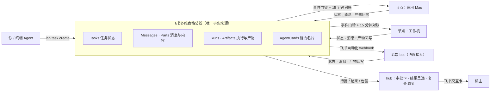
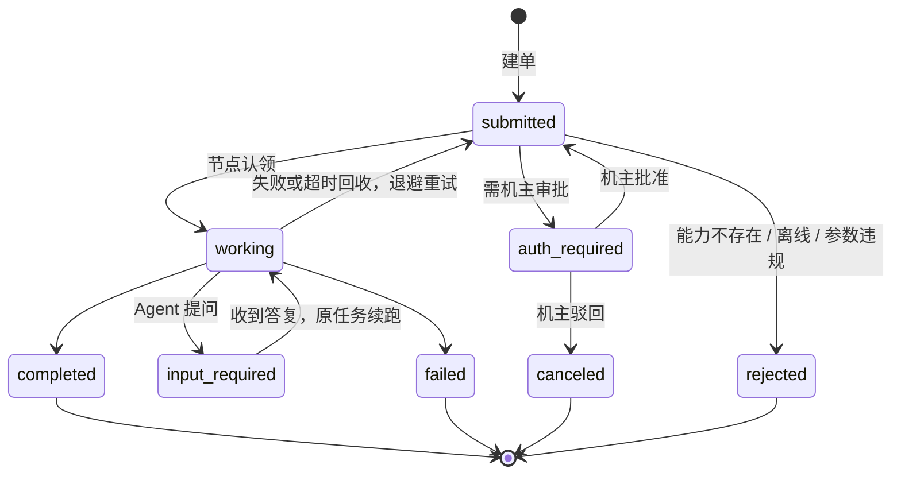

<div align="center">

# lark-a2a-hub

**把飞书多维表格变成多 Agent 的调度总线。**
零服务器、零入站端口、每一步都留痕可查。

[](https://github.com/backtomyfuture/lark-a2a-hub/actions/workflows/check.yml)
[](CHANGELOG.md)
[](docs/standard.md)
[](https://nodejs.org)
[](LICENSE)

[English](README.en.md) · [快速上手](#30-秒上手) · [中台标准](docs/standard.md) · [架构](docs/architecture.md) · [配置参考](docs/configuration.md) · [更新日志](CHANGELOG.md)

</div>

---

你有好几台机器、好几个 Agent：家里的 Mac、工作机、云端的 bot，各自能干点活。
想让它们互相派单、中途提问、需要花钱或发消息时让你点头，通常得自己搭一套服务端。

lark-a2a-hub 的做法是：**不搭服务端，用你已有的飞书多维表格当消息总线和状态层。**
每台机器装一个轻量守护进程 `lah`，它只往外连、不开任何入站端口，认领任务、拉起本机脚本或 Agent、把结果写回表里。
需要机主授权的动作，会在飞书里弹一张审批卡，你点了才执行。

已在生产运行。数据模型借自 [A2A 协议](https://a2a-protocol.org)（八态任务、消息与产物分离、能力名片），通信只读写表，不实现 A2A 的 HTTP 传输。

## 为什么用它

| 你想要 | 它怎么做 |
|---|---|
| **不想运维服务器** | 总线就是飞书多维表格，没有数据库、消息队列、公网入口要管 |
| **任何机器都能入列** | 一行命令安装，向导自动识别本机的 Claude Code、Codex、agy、Paseo、Orca 等，生成能力表 |
| **加能力不改代码** | 三层寻址：节点 → Worker（节点上的 Agent）→ 技能，全写在本机 `commands.json`，内核不含任何具体 Agent 的代码 |
| **危险动作要人点头** | 对外发消息、删改数据、花钱、改权限，走审批卡，只认机主本人 |
| **出了事查得清** | 状态、消息、执行记录、产物全在表里，`lah task why` 一条命令还原时间线 |
| **进程崩了也不乱** | 在途账本保证重启后不二次执行；失败有退避重试、有上限，有熔断 |

## 它怎么工作


<details>
<summary>精确结构图（Mermaid）</summary>



</details>

所有参与者（节点、hub、云端 bot）只做两件事：**读表、写表**。事件推送只是叫醒门铃，内容一律回表拉取，所以断线、重启都不丢活。

谁来接活：


每个 Worker 是机器上的一个 Agent，也是接单的主体；技能挂在 Worker 下面。独立 Agent 节点本尊就是 Worker，确定性脚本由节点本尊直接执行。hub 也是一个节点：图中把它画成独立 Agent 节点，它同样可以是带多个 Worker 的主机节点。

一个任务的生命周期：


<details>
<summary>精确状态图（Mermaid）</summary>



</details>

> 图中 `auth_required`、`input_required` 即标准里的 `auth-required`、`input-required`。终态不可变，后续工作在同一 `Context_ID` 下新建任务。

实测中的一次跨节点协作——hub 拆题、双节点并行、第三个节点拿结论接力核对、结果原路呈递机主：


## 30 秒上手

前置：Node.js >= 24，一个飞书多维表格（向中台管理员要，或自建，见下）。

**1. 安装**

macOS / Linux：

```bash
curl -fsSL https://raw.githubusercontent.com/backtomyfuture/lark-a2a-hub/main/install.sh | sh
```

Windows（PowerShell）：

```powershell
irm https://raw.githubusercontent.com/backtomyfuture/lark-a2a-hub/main/install.ps1 | iex
```

两条命令做同一件事：程序放在 `~/.hub-node/app`（Windows 为 `%USERPROFILE%\.hub-node\app`），不改已有配置。Windows 的命令入口是同目录下的 `bin\lah.cmd` 与 `bin\hub-node.cmd`，安装时加入当前用户的 PATH。当前窗口若还不认识 `lah`，新开一个终端。跳过 Skill：Unix 用 `LAH_SKIP_SKILL=1`，Windows 用 `$env:LAH_SKIP_SKILL=1`。

**2. 向导配置**（自动检测或一键克隆多维表格、解析表 ID、写 600 权限的凭据、识别本机 Agent、订阅事件、自检、可选开机自启）

```bash
lah setup
```

向导里直接回车即可注册开机自启，并马上把守护进程拉起来。macOS 用 LaunchAgent，Linux 用 systemd 用户服务，Windows 用当前用户的任务计划程序：登录时启动，进程异常退出后大约 5 秒再拉起，不限运行时长，不因用电池而停，不需要管理员。日志在配置目录的 `daemon.log`。卸载是 `lah service --remove`。

**3. 验收**

```bash
lah doctor      # 连通性与能力登记
lah daemon      # 前台试跑；setup 里选了自启则已常驻
```

以后升级：已经是 git 检出时运行 `lah update`（先 `lah update --check` 看一眼也行）。它拉取、重装依赖并补齐 Skill，不碰已有配置。压缩包安装没有 `.git`，请重跑上面的安装命令。Windows 的 `lah.cmd` 用相对路径指向 `app\bin\lah.mjs`，更新程序后入口不用重建。

派一个任务，再看回执：

```bash
lah task create --to <节点> --worker <Agent> --text "帮我汇总今天的待办"
lah present --pop               # 取回执，飞书里不刷屏
lah task reply --task TASK-XXXX --text "答复内容"   # 任务向你提问时，原任务续跑
lah task why TASK-XXXX          # 出问题时看时间线
```

向导还会给你的终端 Agent 装上 `lah` Skill（`~/.agents/skills/lah`），Agent 就能自己发起跨节点调度。

**自建中台？** 打开 [飞书多维表格标准模板](https://my.feishu.cn/wiki/OABiwbe3Si1FoCkelzYcYwTQ6de?base_hp_from=larktab&table=tblIvRscY5Mev3Do&view=vewzhNeMCe) 点击右上角「使用该模板」即可一键克隆 7 张标准表（向导 `lah setup` 未扫描到可用 Base 时也会自动弹窗调起该模板页面），随后运行 `lah setup --role hub --owner <机主 open_id>`。一个进程同时担任 hub 与执行节点。详见 [配置参考](docs/configuration.md#7-自建中台hub-角色)。

**云端 bot 没法跑守护进程？** 走飞书自动化 webhook 的协议接入，见 [配置参考](docs/configuration.md#8-接入外部-bot飞书自动化--webhook) 与 [协议节点手册](docs/protocol-node-runbook.md)。

## 能力一览

- **角色合一**：hub 是 node 的单进程超集，`lah daemon --role node|hub`，单进程单目录。
- **节点 / Worker / 技能三层**：一台机器是节点，机器上的每个 Agent 是 Worker，Worker 能做的事是技能。派单可以点名「哪台机器的哪个 Agent 用哪项技能」，也可以只点技能让节点自己挑 Worker；点了名就不会被悄悄换人。名册里每个 Worker 一张名片，技能挂在 Worker 下。
- **能力即配置**：`commands.json` 一条模板接入脚本（`json` 模式）、Agent（`agent` 模式）或常驻 Agent 本尊（`inbox` 模式）。改文件即热更新名片，配置写坏时保留旧表并暂停接新单，修好自动恢复。
- **提问与续跑**：Agent 可以中途向发起方提问（`input-required`），答复后在原任务续跑，不另开新任务；有 session 时可经 `resume_command` 续接同一会话。
- **机主审批**：行级或本机声明为 `approve` 的任务进入 `auth-required`，由 hub 提前发卡，只认机主点击；hub 给每条决定签名，节点配了 hub 公钥后验签，冒写的决定行不生效。
- **在途账本**：`direct` 命令的进程信息先落账本再 spawn。守护重启后进程还在就续心跳、不二次执行；身份对不上不发信号，免得误杀。
- **失败有章法**：重试上限 2 次，60 秒起翻倍退避、封顶 10 分钟；跳数超过 8 熔断；回执无效或提交失败不重跑，避免副作用重复。
- **可观测**：`lah task why` 汇总任务、消息、执行、产物与本机待补交状态；回执可带 `USAGE:` 用量，累计到任务元数据。
- **取消与复查**：`lah task cancel` 撤单；完成回执可带 `LATER:` 预约复查，hub 到点在同一上下文新建复查任务。
- **定时调度**：各节点本地持有独立时钟（`schedules.json` 与 Agent `lah task begin`），到点自动建单并经认领执行；Rules 表单向镜像总览，幂等防重。
- **局域网语境**：macOS 守护进程碰不到局域网，用 `carrier` 在你的终端里代跑；carrier 离线时明确拒收，不静默降级。
- **测试与 CI**：`npm test`（Node 内置 `node:test` 与内存总线，不连真实 Base）覆盖核心路径；GitHub Actions 在 ubuntu / macOS × Node 24 上跑。

## 安全模型

这些是写进标准、写进代码的红线：

- **只出不进**：不开监听端口（carrier 的本地 unix socket 除外），不做端口映射或隧道，不实现入站 webhook。卡片回调也走长连接。
- **指令与数据分离**：执行什么命令、在哪个目录、用哪个语境，只来自本机 `commands.json`。任务正文与参数只作为数据写进一份受限权限的 `input.json`，不拼进指令；参数里夹带执行控制键的任务直接拒收，防提示注入夺权。
- **机主审批**：发消息、删改数据、花钱、提交表单、改权限，一律走审批。审批只认 hub 写入并签名、机主操作的结构化决定，不认文字、不认任务行上的标记。本机可以把审批级别调严，不能放松。
- **凭据不入总线**：密钥只在本机 600 权限的文件里；总线只放任务与文件指针；日志不打印凭据。
- **消息只追加**：Messages、Parts 永不修改或删除，终态任务不可重启，留痕不可篡改。
- **失败要响**：达不到执行条件就明说、标离线、拒收，绝不静默换路径硬跑。

## 设计取舍

本项目的内核设计借鉴了 [agent-autoloop](https://github.com/KKKKhazix/agent-autoloop)（薄内核、命令模板接 Agent、结构化回执、跳数熔断、指令数据分离、一行安装）。差异在于我们要解决的场景：

| | agent-autoloop | lark-a2a-hub |
|---|---|---|
| 状态存哪 | 自带内核数据库，聊天工具做决策面 | 飞书多维表格即总线，读者零自建 |
| 运行形态 | 活在用户会话里 | 无人值守常驻，开机自启 |
| 数据模型 | 自有 | 按 A2A 形状：八态、消息与产物分离、能力名片 |
| 跨机器协作 | 以本机事实日志为核心 | 多节点经同一张表协作，hub 统一审批与呈递 |

我们取了它的韧性与可观测性思路，没有取 SQLite 事实日志、入站 HTTP、第三方插件加载这类与「只出不进、零自建」红线冲突的部分。要让多台机器、多个 Agent 以统一协议协作并留痕，用本项目；其他场景请看它的文档，选合适的。

## 文档

| 文档 | 内容 |
|---|---|
| [docs/configuration.md](docs/configuration.md) | 配置目录、`node.json` / `commands.json`、回执约定、carrier、CLI 速查 |
| [docs/standard.md](docs/standard.md) | **中台标准（权威）**：七表对象模型、八态状态机、通信/审批/幂等协议 |
| [docs/architecture.md](docs/architecture.md) | 分层、核心决策与理由、生命周期、故障模型 |
| [docs/base-schema.md](docs/base-schema.md) · [schema/](schema/) | 七表字段级定义，由线上 Base 生成 |
| [docs/hub-integration.md](docs/hub-integration.md) | hub 职责、建单纪律、呈递与审批回路 |
| [docs/agent-templates.md](docs/agent-templates.md) | 各家无头 CLI 的定版命令、权限语义与已知坑 |
| [docs/protocol-node-runbook.md](docs/protocol-node-runbook.md) | 无守护进程的 Agent 如何按协议盯表接入 |
| [SECURITY.md](SECURITY.md) | 信任模型：防什么、不防什么，部署建议与漏洞报告 |
| [DESIGN.md](DESIGN.md) | 节点适配器设计与 macOS 局域网实测 |
| [CHANGELOG.md](CHANGELOG.md) | 版本变更 |

## 参与

欢迎 issue 与 PR，开始前请读 [CONTRIBUTING.md](CONTRIBUTING.md)。本地验证：

```bash
npm install --omit=dev && npm test
```

## License

[MIT](LICENSE)
