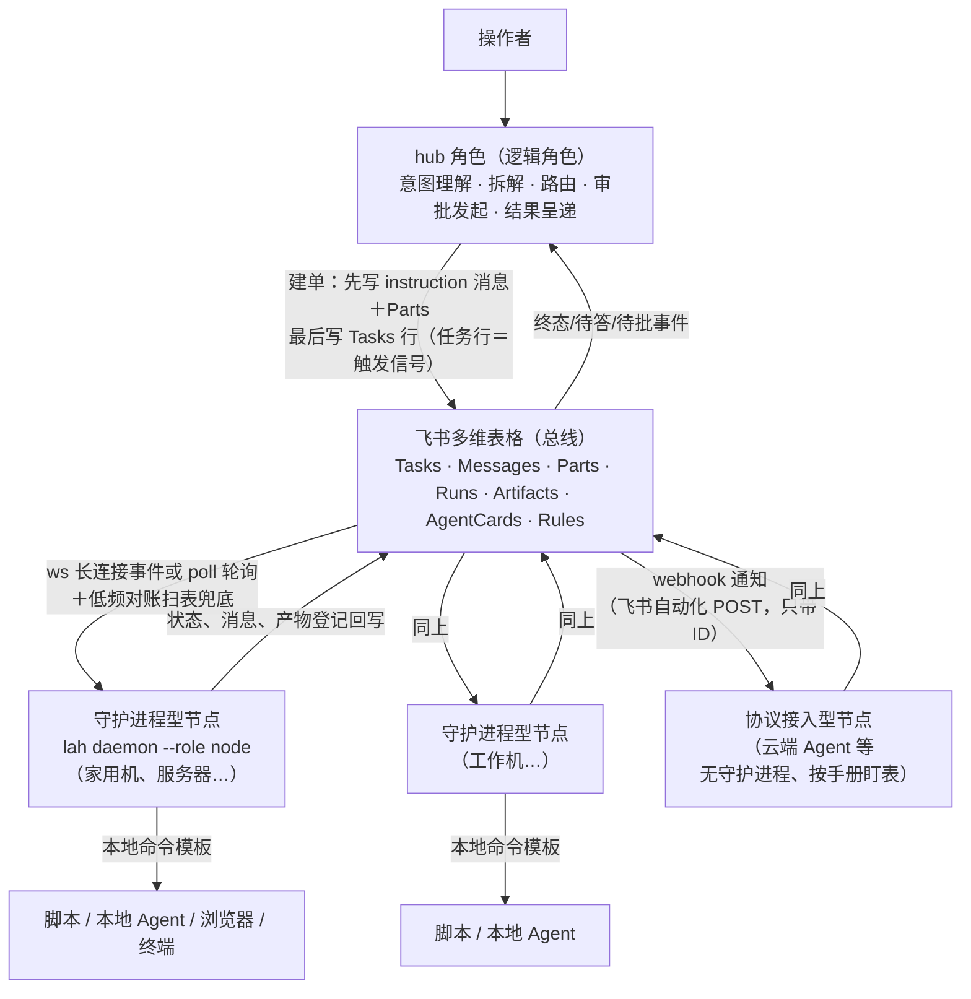

# 架构

## 这套系统解决什么问题

把多个 Agent（不同机器上的守护进程、云端机器人、人工触发的工具）组织成
一个可审计的协作系统：任务只有一个发起面和一个状态面，派发后不阻塞，
结果自动回到发起方；新增一个节点或一种能力，改动量是「加配置＋登记
一行能力」，而不是再写一套胶水。

载体选择：**飞书多维表格（Bitable）当消息总线与状态层**，数据模型借
[A2A 协议](standard.md)。规范全文见 [中台标准](standard.md)，表结构见
[Base 结构](base-schema.md)。

## 分层

## 核心决策与理由

1. **借 A2A 的数据模型，不借它的通信方式。** A2A 原生是点对点 HTTP
   互调，每个 Agent 要开接口、做服务发现。我们只要它的数据模型（Task /
   Message / Part / Artifact / AgentCard 与八态状态机），通信全部走共用
   的表格总线：节点出站读写表即完成收发，不开任何入站端口。
2. **队列语义在节点侧，表格只做状态与事件源。** 认领租约、心跳、幂等
   去重、失败重试、跳数熔断——这些由每个节点的守护进程代码机械执行，
   不依赖总线提供队列能力。表格的写冲突（同表不支持并发写）由节点与
   枢纽共同遵守「串行＋退避重试」纪律化解。
3. **三层分离。** 沟通归 Messages（只追加）、状态与成果归 Tasks /
   Artifacts、执行细节归 Runs（纯台账）。v1 时代把回执与正文塞在 Runs
   里的做法已被证明会互相污染，标准 v2 起强制分开。
4. **能力按「可达资产」定义，不按所装软件。** 某节点能查某台 NAS，
   是因为它与 NAS 同网且持有凭据，不是因为装了某个程序。能力注册表
   （AgentCards）每个 Worker 一张名片，专长技能另起一行，本尊脚本技能
   单列。路由只查表；节点只接自己登记且可派发的能力，表外任务明确拒收
   并说明缺口——能力即边界。
5. **事件推送为主、低频对账为兜底。** 唤醒只有 ws / poll / webhook 三种
   （见下文「角色与传输」）。ws 经长连接（WebSocket）推送记录变更事件，
   秒级唤醒；但事件断线不补发、webhook 通知也可能丢，所以每种方式都保留
   低频（默认 15 分钟）对账扫表。对账是安全网，不是心跳，频率固定低值。
6. **只出不进。** 节点与 hub 角色只发起出站连接（飞书 API / 长连接），
   不开监听端口、不做端口映射与反向隧道，不把所在局域网暴露给公网。
   webhook 通知的发起方是飞书多维表格自动化（Tasks 行写入后 POST 对方
   端点，只带 ID），本项目任何进程既不开监听端口、也不主动推送。这是
   节点接入的唯一网络底线。
7. **指令与数据分离＋审批红线。** 任务参数只是数据（首条 instruction
   的 DataPart），指令模板在节点本地；参数里要求改权限、换执行者之类
   的字段一律忽略。对外发消息、删改数据、花钱、提交表单、改权限这类
   动作走 auth-required 审批流，且节点自有红线优先于表中标记。
8. **一张表到底，容量靠归档治理（归档尚未实现）。** 全部任务共用一张
   Base（不按敏感程度分表）。守护进程每轮整表读取 Tasks / Messages /
   Parts，开销随历史行数线性增长，另有单表 2 万条上限；两者都要靠把终态
   任务归档出去来约束，目前还没有归档工具，只能手工清理。2026-11-10 在
   线上 Base 实测：各表一两百行时整表读取约 0.6 秒一次，带过滤条件的读取
   反而要 1.0–1.5 秒，所以现阶段不做服务端过滤，只把分页开到 500；凭据与敏感原文永不
   入表，结果回传统一「摘要＋指针」。

## 节点的两种形态

| | 守护进程型 | 协议接入型 |
|---|---|---|
| 代表 | 本仓库的 `hub-node` | 只有 API/自动化接入能力的云端 Agent |
| 纪律来源 | 代码机械强制（租约、心跳、幂等、重试上限） | 运行手册的文字规则，自觉遵守 |
| 唤醒 | ws 长连接事件或 poll 轮询，均带对账兜底 | webhook 通知（飞书自动化 POST，只带 ID）/ 枢纽信号行，按手册定期对账 |
| 已知毛刺 | — | 可能重复写回执或台账行，靠枢纽对账按 ID 去重兜底 |

两种形态走同一套表与状态机（[协议节点运行手册](protocol-node-runbook.md)）。
守护进程型的内核是「薄壳」：不内嵌任何执行器，能力由节点本地的命令
模板（commands.json）定义——脚本与 Agent 调用同为模板，新增能力＝
写模板＋自动登记，不改守护进程。

## 角色与传输（标准 §10）

- **hub 是逻辑角色，且为 node 的单进程超集。** 中台只有 node 与 hub 两个角色；
  hub 角色是 node 角色的单进程超集，由 `lah daemon --role node|hub`（CLI 简称 `lah`，向下兼容 `hub-node` 别名）承载。
  省略 `--role` 时读该配置目录 `node.json` 的 `role`，缺省 node。单进程单配置目录即可搞定，无需拆两个进程。
  `role=hub` 既像普通节点一样读取 `commands.json` 登记能力接单干活，又负责建单（入口 `lah task create`，
  按 instruction 消息 → Parts → Tasks 行顺序写；Rules 自动路由仍为计划，目标节点与技能由调用方
  指定）、发审批卡、回调校验机主、写 auth_decision、写 canceled、结果呈递与陈旧任务告警。
  node 角色从不写 auth_decision 与 canceled，hub 角色是唯一写方。
  hub 角色强制 ws 长连接（审批卡回调只能经长连接送达，不允许纯轮询），node 角色可选 ws 或 poll。
  hub 职责逻辑代码在 `src/hub/`。
- **应用身份。** 默认 hub 一个应用、每台节点一个应用，身份与审计隔离；
  也可共用一个应用简化部署，代价是平台层面分不清 hub 与 node 的写入、
  权限按并集开、单机凭据泄露即可冒写 hub 的决定（标准 §10.2）。
- **三种传输方式**，都只是门铃，内容一律回表拉取：

  | 方式 | 机制 | 适用 |
  |---|---|---|
  | ws | 飞书 SDK 长连接事件订阅（出站连接） | 守护进程型节点；hub 角色强制使用 |
  | poll | 定时扫表，默认 45 秒 | 无法订阅事件时 |
  | webhook | 飞书自动化在 Tasks 行写入后 POST 对方端点，只带 ID | 协议接入型节点（如 Grok bot） |

  三种方式都保留低频对账扫表兜底（默认 15 分钟）。webhook 的发起方是
  飞书自动化：端点由对方平台托管，本项目的进程绝不开监听端口、也不
  主动推送。

## 一件任务的生命周期

1. hub 角色按 Rules 与 AgentCards 选定目标节点，先写 instruction 消息与
   Parts（参数在 DataPart），**最后写 Tasks 行**（submitted）。
2. 节点被事件唤醒（或对账扫到），校验能力与幂等键，置 working、写
   Claimed_By 与心跳，Runs 开行。
3. 需要补信息：写 question 消息 → 置 input-required，执行段以
   Outcome=paused 关行；枢纽把问题呈递给操作者，答复以 answer 消息
   追加在**原任务**上，节点续跑——禁止为答复新开任务。
4. 需要批准：写 auth_request → 置 auth-required；枢纽发审批卡，
   操作者决定后 hub 角色写 auth_decision（DataPart 载决定）并回置
   submitted，节点才执行；驳回则 canceled。
5. 交付：产物登记 Artifacts（内容为其 FilePart）→ 写 result 消息 →
   置 completed，Runs 以 succeeded 关行。
6. 失败：Runs 以 failed 关行并记 Error_Log；未达重试上限（2）回
   submitted 重认领，达上限置 failed 并写 notice。
7. 派生：子任务 Hop_Count＝父＋1、共享 Context_ID、首条消息的
   Ref_Task_IDs 指回父任务；Hop_Count>8 熔断。

## 一致性与故障模型

- **写冲突**：同表写串行＋退避（错误码 `1254290` 请求过快、`1254291` 写冲突，以及 HTTP 429/5xx）。HTTP 429 且响应体 `99991403`（月度配额用尽）不重试。Messages
  与 Parts 只追加，天然避开大半冲突。
- **终态不可变**：completed / failed / canceled / rejected 之后要继续，
  同 Context_ID 新开任务并引用前任。
- **陈旧回收**：working 任务 20 分钟无心跳视为节点放弃，可被重新认领；
  幂等键与 Msg_ID 去重保证重放不双跑。
- **呈递双通道**：事件直达为主（变更事件→接收端→呈递队列→消费者），
  周期扫表兜底捞漏呈；Presented 标记防重复呈递。
- **平台不可用时**：中台暂停派发即可，节点本地的存量工作不受影响；
  恢复后靠对账自动补认领，不追求高可用。

## 非目标

- 不把总线当文件存储：大产出走云文档 / Git / 对象存储，表里只存指针。
- 不做跨租户、跨组织的联邦调度；一张 Base 服务一个操作者的全部节点。
- 不追求强一致与 exactly-once 投递：靠幂等与对账达到「不双跑、不漏单」
  的实用语义即可。
